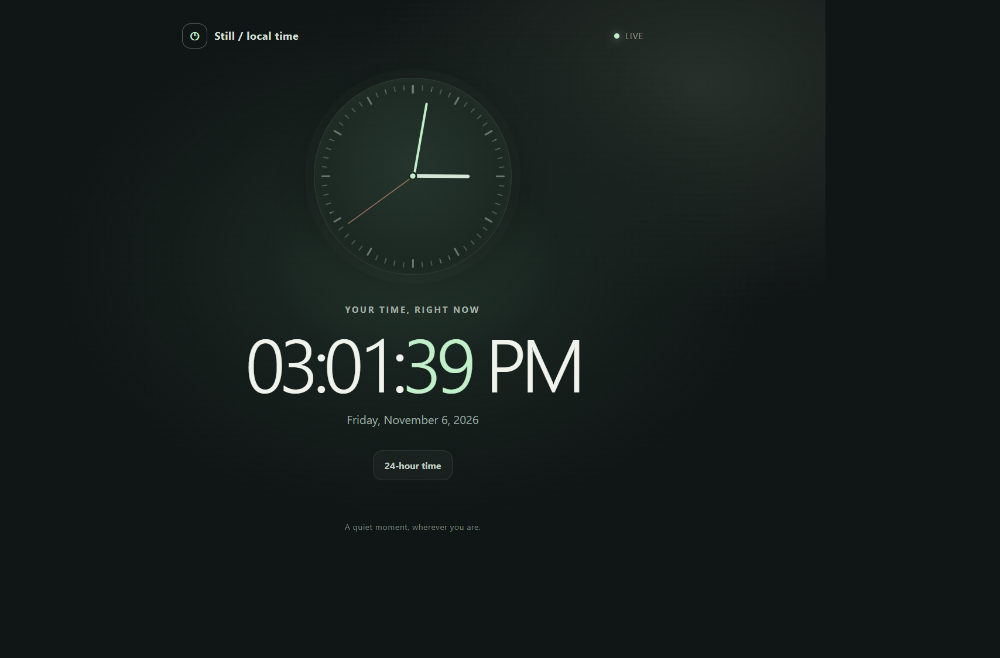

# Still Digital Clock

A minimal live clock with a moving analog dial, local date, and a 12/24-hour time switch.

## Features

- Live digital time and animated analog dial
- Localized date and time
- Switch between 12-hour and 24-hour formats
- Responsive layout with no external dependencies

## Run locally

Open `index.html` in a browser. No build step or external dependencies are required.

## Deployment

GitHub Pages deploys automatically from `main` through the included Actions workflow.

## Live demo

https://srisaikumar6.github.io/digital-clock/
